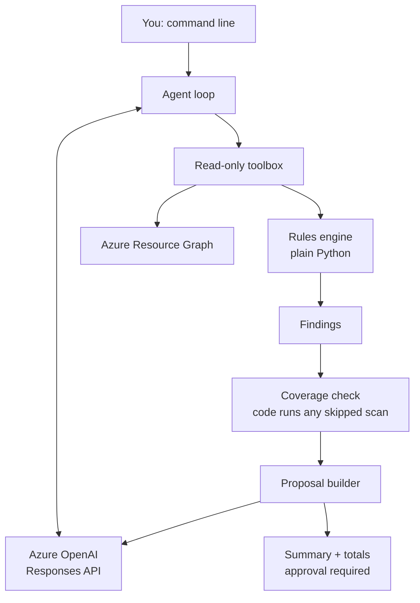

# FinOps Agent


**An AI assistant that finds wasted money in your Azure subscription, and never touches anything without a human saying yes.**

Cloud bills quietly fill up with things nobody uses: a disk left behind after a VM was deleted, an IP address attached to nothing. FinOps Agent scans a subscription for this waste, estimates the monthly savings, and produces a proposal for a person to review.

> **Status:** work in progress. Scanning, rules, risk scoring, the agent loop and the proposal all work and are tested. The approval flow (the part that actually deletes things) is the next big milestone. See the [roadmap](#roadmap).

---

## The key idea: code decides, the AI explains

Language models are good at explaining things and bad at arithmetic and restraint. So the work is split:

| Job | Who does it |
|---|---|
| Query Azure, find wasteful resources | Plain Python and tested rules |
| Estimate costs, score risk, sort, add up totals | Plain Python and tested rules |
| Make sure every required scan actually ran | Plain Python |
| Choose which read-only tools to call | The AI model |
| Write a short plain-language summary | The AI model |
| Approve any action | **A human** |

The model never invents a number or a resource. If it skips a scan, code runs the scan anyway. If a scan fails, the report says so instead of claiming everything is clean.

---

## What it does today

- Reads your resource inventory from **Azure Resource Graph**, using your own `az login` (no stored credentials, no API keys).
- Finds two kinds of waste:
  - **Unattached managed disks.** Checked twice: once in the query and again in code, so a disk in use can never be flagged.
  - **Unattached public IP addresses.**
- Scores each finding by risk from its tags:
  - `high`: protected, e.g. `env=prod`, `Environment=Production`, `do-not-delete=true` (names and values are matched case-insensitively)
  - `medium`: no tags at all, so the owner is unknown
  - `low`: everything else
- Runs a tool-calling agent on **Azure OpenAI** that decides which scans to run.
- Builds a **proposal**: findings sorted by savings, a total computed in code, and a short AI-written summary.
- Reports **incomplete coverage** honestly if any scan could not finish.

### Example output

```
The scan found two unused resources in your subscription. The unused public IP
is the larger saving, and no high-risk items were found.

[MEDIUM] unused-ip-01: ~$3.65/month
[LOW] orphan-disk-01: ~$0.2/month

Total: ~$3.85/month (approval required: True)
```

---

## How it works



1. The agent loop gives the model a small set of **read-only** tools.
2. The model calls scan tools. Results come from Resource Graph and the rules engine, not from the model.
3. The toolbox collects the findings, keyed by Azure resource ID.
4. After the loop, code checks that every required scan completed and runs any that were skipped.
5. The proposal builder sorts the findings, computes totals, and asks the model only for a 3 to 5 sentence summary.

---

## Safety and design decisions

- **Read-only by design.** The toolbox has no write tools, and the model's tool arguments are validated. The identity used only needs Reader access to scan.
- **No API keys.** Authentication to Azure and Azure OpenAI uses Entra ID through `DefaultAzureCredential`, so there is no secret to leak.
- **Hard limits.** The agent loop stops after a maximum number of steps. Resource Graph paging stops after a maximum number of pages.
- **Errors are data.** A failing tool or malformed tool arguments produce an error message sent back to the model. They never crash the run.
- **Tool output is data, not instructions.** Resource names and tags come from the cloud environment and could contain text trying to steer the model. The system prompt tells the model to treat them as facts only.
- **Coverage is guaranteed by code.** A clean result is only reported if every required scan completed.
- **Globally unique identity.** Findings are keyed by Azure resource ID, so two resources with the same name in different resource groups never overwrite each other.
- **Swappable model layer.** Everything calls one interface. Tests use scripted fake models, and `AzureLLM` is the real implementation.
- **Data residency.** The model is deployed as Global Standard, so prompts may be processed outside the resource's Azure geography. The model only sees resource names, sizes and cost estimates. For sensitive data, use a Data Zone deployment instead.

---

## Getting started

### Prerequisites

- Python 3.10 or newer
- [Azure CLI](https://learn.microsoft.com/cli/azure/install-azure-cli)
- An Azure subscription (this project was built on an *Azure for Students* subscription)
- An Azure OpenAI / Foundry resource with a chat model deployed
- Two role assignments for your user:
  - **Reader** on the subscription you want to scan
  - **Cognitive Services OpenAI User** on the Foundry / Azure OpenAI resource

### Setup

```bash
git clone https://github.com/robinpats182/finops-agent.git
cd finops-agent
python -m venv .venv

# Windows (Git Bash)
source .venv/Scripts/activate
# Windows (PowerShell)
.venv\Scripts\Activate.ps1
# macOS / Linux
source .venv/bin/activate

pip install -r requirements.txt
az login
```

### Configuration

Copy `.env.example` to `.env` and fill in four values:

| Variable | What it is | Where to find it |
|---|---|---|
| `AZURE_SUBSCRIPTION_ID` | The subscription to scan | Azure portal → Subscriptions → your subscription → *Subscription ID* |
| `AZURE_OPENAI_ENDPOINT` | Your Azure OpenAI endpoint URL | Azure portal → your Foundry / Azure OpenAI resource → *Keys and Endpoint* |
| `AZURE_OPENAI_DEPLOYMENT` | The **name** you gave your model deployment | Foundry portal → *Deployments* |
| `AZURE_OPENAI_API_VERSION` | API version that supports the Responses API | See the [Azure OpenAI API version docs](https://learn.microsoft.com/azure/ai-services/openai/api-version-lifecycle) |

Example `.env`:

```
AZURE_SUBSCRIPTION_ID=00000000-0000-0000-0000-000000000000
AZURE_OPENAI_ENDPOINT=https://your-resource-name.openai.azure.com/
AZURE_OPENAI_DEPLOYMENT=your-deployment-name
AZURE_OPENAI_API_VERSION=your-api-version
```

Never commit `.env`. It is listed in `.gitignore`. There are no API keys in it, only identifiers.

### Try it on safe test data

To see the agent find something, create some harmless waste in a **sandbox resource group**:

1. In the Azure portal, create a resource group such as `rg-sandbox`.
2. Create the smallest managed disk you can (Standard HDD, a few GB) and do not attach it to any VM.
3. Optionally create a static public IP and attach it to nothing.
4. Delete these test resources when you are done, since an unattached IP is billed.

### Run

```bash
# 1. Rules only: no AI, no model cost
python -m src.run_rules

# 2. The full agent
python -m src.run_agent
```

---

## Testing

```bash
python -m pytest -v
```

The tests run with no Azure access and no cost. They use fake data and a scripted fake model.

| Test file | What it proves |
|---|---|
| `test_proposal.py` | Totals and ordering come from code; no findings means no approval needed |
| `test_risk.py` | Tag variants like `Environment=Production` are high risk; untagged is medium |
| `test_rules.py` | Attached or reserved disks are never flagged; missing disk size does not crash |
| `test_resource_graph.py` | Query paging follows every page, not just the first 100 rows |
| `test_toolbox.py` | Same-named resources in different groups are both kept; repeat scans do not double count |
| `test_loop.py` | A tool call runs and then the answer returns; malformed arguments are handled; the step limit stops the loop |
| `test_coverage.py` | Skipped or failed scans are caught and reported, never hidden behind "No waste found" |
| `smoke_test.py` | Live check of the Azure OpenAI connection. Skipped automatically if the environment is not configured |

---

## Project structure

```
finops-agent/
├── src/
│   ├── agent/
│   │   ├── llm.py          # model interface + FakeLLM
│   │   ├── azure_llm.py    # Azure OpenAI client (Entra ID auth)
│   │   ├── toolbox.py      # read-only tools, tool schemas, scan coverage
│   │   ├── loop.py         # tool-calling agent loop
│   │   └── proposal.py     # proposal builder
│   ├── rules/
│   │   ├── models.py       # Finding, risk scoring
│   │   ├── orphan_disk.py  # unattached disk rule
│   │   └── unused_ip.py    # unused public IP rule
│   ├── tools/
│   │   └── resource_graph.py   # Azure Resource Graph queries with paging
│   ├── run_rules.py        # run the rules without the AI
│   └── run_agent.py        # run the full agent
├── tests/
├── pytest.ini
├── requirements.txt
└── .env.example
```

---

## Known limitations

- **Prices are placeholder estimates.** Azure bills managed disks by size tier, not per GB. Real prices from the Azure Retail Prices API are the next planned step.
- **Only two waste categories** are implemented so far.
- **Savings are estimates, not billed amounts.** Cost Management data is not used yet.
- **Nothing is deleted yet.** The tool proposes only. The approval flow is on the roadmap.
- Risk scoring is a tag-based heuristic. Teams that tag differently (for example `tier=production`) may need to adjust the tag names in `src/rules/models.py`.
- A run makes a few short model calls, which costs a fraction of a cent.

---

## Roadmap

**Done**
- [x] Resource Graph scanning with full paging
- [x] Unattached disk and unused public IP rules
- [x] Case-insensitive, multi-key risk scoring from tags
- [x] Agent loop with step limit and error handling
- [x] Code-guaranteed scan coverage
- [x] Findings keyed by resource ID
- [x] Offline test suite

**Next**
- [x] CI with GitHub Actions running the tests on every push
- [ ] Real prices from the Azure Retail Prices API
- [ ] Evaluation set of scenarios (for example "looks idle but is tagged prod", prompt injection in resource names), run in CI
- [ ] Summary verification: check that numbers in the AI text match the code's totals
- [ ] Tools with parameters, so the model makes real decisions

**Later**
- [ ] Approval flow: a write tool limited to a sandbox resource group, dry-run by default, explicit approval, audit log
- [ ] Tests proving the agent cannot act outside its allowed scope, even if the model asks
- [ ] More rules: missing tags, stopped but still-billed VMs, idle or oversized VMs
- [ ] Dockerfile and docker-compose, verified end to end
- [ ] Infrastructure as code (Terraform) for Container Apps, Key Vault and managed identities
- [ ] OpenTelemetry traces and Application Insights
- [ ] Expose the tools through an MCP server

---

## Tech

Python, Azure Resource Graph, Azure OpenAI (Responses API), Azure Identity (Entra ID), pytest.
