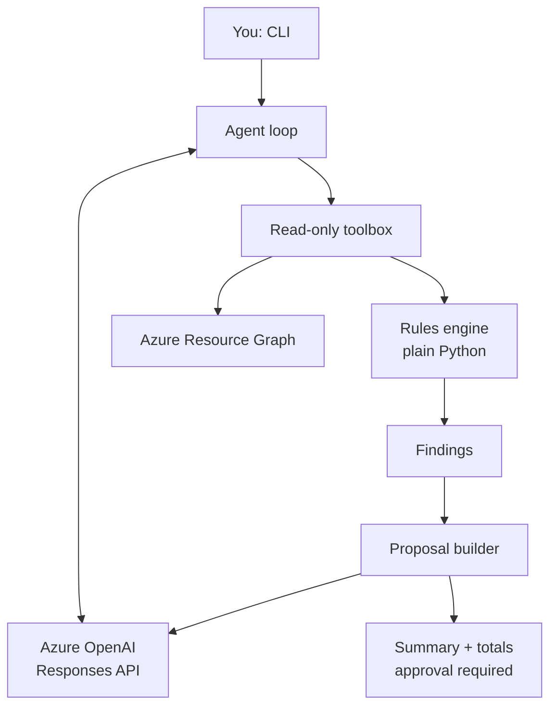

# FinOps Agent

An agentic cost-optimization assistant for Azure. It scans a subscription for wasteful resources, estimates the savings, and produces a proposal for a human to approve.

**Design rule:** deterministic code finds the problems and does all the math. The LLM only chooses which read-only tools to call and explains the verified findings. The model never invents a number or a resource.

> **Status:** work in progress. The scanning, rules, proposal and agent loop work today. The approval flow, containerized deployment and CI/CD are on the roadmap below.

## What it does today

- Queries Azure Resource Graph for the resource inventory, using your own Azure login (no stored credentials).
- Applies tested rules to find waste:
  - managed disks not attached to any VM
  - public IP addresses not attached to anything
- Scores each finding by risk from resource tags (`env=prod` is high risk, untagged is medium, everything else is low).
- Runs a tool-calling agent loop on Azure OpenAI that decides which scans to run.
- Builds a proposal where code computes the total and the sort order, and the LLM writes only the plain-language summary.

Example output:

```
[MEDIUM] unused-ip-01: ~$3.65/month
[LOW] orphan-disk-01: ~$0.2/month

Total: ~$3.85/month (approval required: True)
```

## Architecture



1. The agent loop gives the model a small set of read-only tools.
2. The model calls the scan tools. Tool results come from Resource Graph and the rules engine.
3. Findings are collected by the toolbox, not by the model.
4. A separate step builds the proposal from those verified findings and asks the model only for a short summary.

## Design decisions

- **Code decides, the model explains.** Costs, risk levels, ordering and totals come from tested functions. This keeps the output verifiable and easy to evaluate.
- **Swappable model layer.** Everything calls one `complete()` interface. A `FakeLLM` is used for tests and offline work, and `AzureLLM` is the real implementation.
- **No API keys.** The app authenticates to Azure OpenAI and Azure with Entra ID (`DefaultAzureCredential`), so there is no secret to leak.
- **Hard step limit.** The agent loop stops after a maximum number of steps, so it cannot loop forever or run up costs.
- **Tool errors are data.** A failing tool returns an error to the model instead of crashing the loop.
- **Tool output is treated as data, not instructions.** Resource names and tags come from the cloud environment and could contain text that tries to steer the model. The system prompt tells the model to use tool results as facts only.
- **Loop gathers evidence, a separate step writes the report.** The summary prompt only receives the sorted, code-checked findings.
- **Data residency.** The model is deployed as Global Standard, so prompts may be processed outside the resource's Azure geography. The model only sees resource names, sizes and cost estimates from the scanned subscription. For sensitive data, use a Data Zone deployment instead.

## Project structure

```
finops-agent/
├── src/
│   ├── agent/
│   │   ├── llm.py          # LLM interface + FakeLLM
│   │   ├── azure_llm.py    # Azure OpenAI client (Entra ID auth)
│   │   ├── toolbox.py      # read-only tools + tool schemas
│   │   ├── loop.py         # tool-calling agent loop
│   │   └── proposal.py     # proposal builder
│   ├── rules/
│   │   ├── models.py       # Finding, risk scoring
│   │   ├── orphan_disk.py
│   │   └── unused_ip.py
│   ├── tools/
│   │   └── resource_graph.py
│   ├── run_rules.py        # run rules without the LLM
│   └── run_agent.py        # run the full agent
├── tests/
├── pytest.ini
├── requirements.txt
└── .env.example
```

## Getting started

### Prerequisites

- Python 3.10 or newer
- [Azure CLI](https://learn.microsoft.com/cli/azure/install-azure-cli)
- An Azure subscription (this project was built on an Azure for Students subscription)
- An Azure OpenAI / Foundry resource with a chat model deployed
- Role assignment: **Cognitive Services OpenAI User** on the Foundry resource, and read access (Reader) on the subscription you want to scan

### Setup

```bash
git clone <your-repo-url>
cd finops-agent
python -m venv .venv

# Windows
.venv\Scripts\activate
# macOS / Linux
source .venv/bin/activate

pip install -r requirements.txt
az login
```

Copy `.env.example` to `.env` and fill in your values:

```
AZURE_SUBSCRIPTION_ID=your-subscription-id
AZURE_OPENAI_BASE_URL=your-azure-openai-base-url
AZURE_OPENAI_DEPLOYMENT=your-deployment-name
```

Never commit `.env`. It is listed in `.gitignore`.

### Run

```bash
# Rules only, no LLM and no model cost
python -m src.run_rules

# Full agent
python -m src.run_agent

# Tests (no Azure access needed)
python -m pytest -v
```

## Testing

The tests run without Azure access or any cost:

- Rule tests use fake resource data and check costs and risk levels.
- Proposal tests check that totals and ordering come from code.
- Agent loop tests use a scripted fake model to check that the loop calls a tool and then answers, and that it stops at the step limit.

## Cost and limitations

- Prices in the rules are **placeholder estimates**. Azure bills managed disks by size tier rather than per GB. Replacing these with the Azure Retail Prices API is planned.
- Only two waste categories are implemented so far (unattached disks and unused public IPs).
- Cost Management data is not used yet, so savings are estimates, not billed amounts.
- A run makes a few short model calls, which costs a fraction of a cent.

## Roadmap

- [ ] Approval flow: a write tool limited to a sandbox resource group, dry-run by default, explicit approval, audit log
- [ ] Tests proving the agent cannot act outside the allowed scope, even if the model asks
- [ ] More rules: idle or oversized VMs, missing tags
- [ ] Real prices from the Azure Retail Prices API
- [ ] Dockerfile and docker-compose
- [ ] Infrastructure as code (Terraform) for Container Apps, Key Vault and managed identities
- [ ] CI/CD with GitHub Actions and OIDC federation
- [ ] Evaluation set (scenario cases, including "looks idle but is tagged prod") run in CI
- [ ] OpenTelemetry traces and Application Insights
- [ ] Expose tools through an MCP server

## Tech

Python, Azure Resource Graph, Azure OpenAI (Responses API), Azure Identity (Entra ID), pytest.